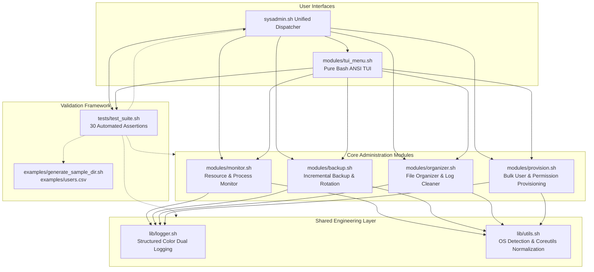

# OS Admin CLI Suite: Modular System Administration Toolset

[](https://www.gnu.org/software/bash/)
[](https://kernel.org)
[](https://apple.com)
[](https://learn.microsoft.com/en-us/windows/wsl/)
[-brightgreen?style=flat-square)](#automated-test-suite)
[](https://github.com/mostafizcse007/Shell-Script/actions/workflows/ci.yml)
[](LICENSE)

An industrial-grade, POSIX-compliant modular system administration command-line suite and interactive TUI built for **Operating Systems Lab** coursework. It demonstrates core operating system principles including process and resource scheduling inspection, incremental archive storage management with cryptographic verification, filesystem categorization and log maintenance, identity and access provisioning, and signal-trapped lifecycle safety.

---

## 1. Problem Statement & Academic Context

Modern system administration requires robust, dependable tooling capable of operating across heterogeneous Unix and Unix-like environments without introducing complex runtime dependencies. In systems programming and administration, critical challenges include:
- **Resource Monitoring & Bottleneck Identification**: Capturing accurate CPU, memory, and disk telemetry while alerting before thresholds cause denial-of-service.
- **Storage Management & Backup Integrity**: Implementing space-efficient incremental backups while guaranteeing cryptographic integrity and safeguarding parent backup chains from accidental deletion.
- **Filesystem Governance & Log Rotation**: Mitigating disk-space exhaustion through automated categorization, age/size log pruning, and non-destructive quarantine workflows.
- **Access Control & Bulk Provisioning**: Programmatically managing user lifecycles, group assignments, login shells, and elevated privileges from structured datasets (CSV) with pre-flight collision checks.
- **Fault-Tolerant Execution**: Ensuring scripts adhere to strict fault handling (`set -euo pipefail`), signal cleanup (`SIGINT`, `SIGTERM`, `EXIT`), and simulation modes (`--dry-run`) to prevent unintentional modifications during evaluation.

This toolset provides a unified, cross-platform solution satisfying all of the above principles using pure Bash and core operating system utilities.

---

## 2. System Architecture



---

## 3. Modular Feature Breakdown

### Module 1: System Resource & Process Monitor ([`modules/monitor.sh`](file:///d:/OS%20Project/modules/monitor.sh))
- **Diagnostic Snapshot Mode**: Outputs formatted ASCII telemetry tables summarizing CPU load, Memory/Swap utilization, root partition disk space, and top $N$ CPU-consuming processes.
- **Continuous Live Watch Mode**: Interactive polling loop refreshing every $N$ seconds with clean screen redraw and graceful `SIGINT` (Ctrl+C) handling.
- **Multi-Channel Threshold Alert Engine**: Triggers red visual indicators, writes incident logs to `logs/sysadmin.log`, and dispatches desktop notifications (`notify-send` on Linux, `osascript` on macOS, Balloon notifications on Windows).
- **Cross-Platform Telemetry**: Seamlessly normalizes metrics across Linux (`/proc/stat`, `/proc/meminfo`), macOS (`top`, `vm_stat`), and Windows Git Bash (`Get-CimInstance`).

### Module 2: Incremental Backup & Rotation Manager ([`modules/backup.sh`](file:///d:/OS%20Project/modules/backup.sh))
- **Dual-Engine Incremental Architecture**: Automatically leverages GNU tar (`--listed-incremental`) with transparent fallback to BSD tar (mtime snapshotting).
- **Multi-Level Backups**: Automatically creates Level-0 full base archives (`*_L0_*.tar.gz`) or Level-1 incremental archives (`*_L1_*.tar.gz`).
- **Cryptographic SHA-256 Manifest**: Calculates and appends hashes to `SHA256SUMS` in the target destination.
- **Archive Integrity Verification**: The `--verify <archive>` subcommand validates archive decompression and confirms hash matches against `SHA256SUMS`.
- **Chain-Safe Retention Invariant**: Prunes old backups when `--retention <N>` is exceeded, with the strict guarantee that **a Level-0 base backup is never deleted while dependent incremental archives still exist**.

### Module 3: Automated File Organizer & Log Cleaner ([`modules/organizer.sh`](file:///d:/OS%20Project/modules/organizer.sh))
- **Category Classification**: Organizes unorganized directories into categorized subfolders:
  - `Documents/`: `.pdf`, `.doc`, `.docx`, `.txt`, `.md`, `.rtf`, `.odt`, `.xls`, `.xlsx`, `.ppt`, `.pptx`, `.csv`
  - `Images/`: `.png`, `.jpg`, `.jpeg`, `.gif`, `.bmp`, `.svg`, `.webp`, `.ico`
  - `Media/`: `.mp4`, `.mkv`, `.avi`, `.mov`, `.mp3`, `.wav`, `.flac`, `.aac`
  - `Archives/`: `.zip`, `.tar`, `.gz`, `.bz2`, `.xz`, `.7z`, `.rar`, `.tgz`
  - `Code/`: `.c`, `.cpp`, `.h`, `.py`, `.sh`, `.js`, `.ts`, `.html`, `.css`, `.java`, `.go`, `.rs`, `.json`, `.yaml`
- **Collision Avoidance**: Automatically appends timestamps to duplicate filenames, preventing accidental data overwrites.
- **Log Pruning & Compression**: Finds `.log` files and purges logs older than `--older-than <days>` while compressing logs exceeding `--max-size <MB>` to `.log.gz`.
- **Quarantine Staging**: Supports `--quarantine <dir>` to stage files scheduled for deletion instead of immediately removing them.

### Module 4: Bulk User & Permission Provisioning ([`modules/provision.sh`](file:///d:/OS%20Project/modules/provision.sh))
- **CSV Ingestion**: Parses standard CSV schemas: `username,group,shell,home_dir,sudo_flag,initial_password`.
- **Account & Group Governance**: Creates missing groups, provisions home directories, configures login shells, sets initial passwords, and assigns administrative (`sudo`/`wheel`/`admin`) permissions.
- **Collision Safety**: Checks whether users or groups already exist to prevent clobbering existing accounts.
- **De-provisioning Rollback**: The `--deprovision` flag cleanly removes the accounts and home folders specified in the CSV.
- **Privilege Isolation**: Enforces root check for live execution, but allows full execution under `--dry-run` so lab instructors can evaluate and test without root access.

### Module 5: Pure-Bash ANSI TUI Dashboard ([`modules/tui_menu.sh`](file:///d:/OS%20Project/modules/tui_menu.sh))
- **Zero-Dependency Terminal Interface**: Built 100% in pure Bash using ANSI escape sequences (`\033[...`). Requires no third-party packages (`dialog`, `whiptail`, or `curses`).
- **Interactive Navigation**: Supports arrow keys (`↑`/`↓`), Vi keys (`k`/`j`), direct numeric shortcuts (`1`–`7`), and `Enter` selection.
- **Integrated Wizards**: Interactive forms for module configuration, plus an integrated real-time log viewer and test suite launcher.

---

## 4. Quickstart & Command-Line Reference

The toolset can be driven through the unified root dispatcher [`sysadmin.sh`](file:///d:/OS%20Project/sysadmin.sh) or by directly executing scripts under `modules/`.

### Subcommand Reference

```bash
# ==============================================================================
# Interactive Lab Evaluation Demo (Single Command)
# ==============================================================================
./demo.sh                                                            # Interactive evaluation runner (prompts between steps)
./demo.sh --auto                                                     # Automated unattended demonstration run

# ==============================================================================
# Unified CLI Dispatcher Subcommands
# ==============================================================================
# Display help and detected OS architecture
./sysadmin.sh --help
./sysadmin.sh version

# 1. System Resource & Process Monitor
./sysadmin.sh monitor --snapshot                     # Single diagnostic snapshot
./sysadmin.sh monitor --watch 2                      # Live monitoring every 2s
./sysadmin.sh monitor --cpu-threshold 75 --top-n 10  # Custom threshold and process count
./sysadmin.sh monitor --snapshot --dry-run           # Test alert engine without sending notifications

# 2. Incremental Backup & Rotation Manager
./sysadmin.sh backup --source ./data --dest ./backups --retention 3  # Level-0/Level-1 backup
./sysadmin.sh backup --source ./data --dest ./backups --full         # Force Level-0 full backup
./sysadmin.sh backup --verify ./backups/backup_data_L0_latest.tar.gz # Verify integrity & checksum
./sysadmin.sh backup --source ./data --dest ./backups --dry-run      # Simulate backup & rotation

# 3. Automated File Organizer & Log Cleaner
./sysadmin.sh organize --target ~/Downloads --organize               # Sort loose files
./sysadmin.sh organize --target ~/Downloads --organize --dry-run     # Preview organization moves
./sysadmin.sh clean --target ./logs --older-than 14 --max-size 50     # Prune & compress logs
./sysadmin.sh clean --target ./logs --older-than 7 --quarantine ./q   # Quarantine old logs

# 4. Bulk User & Permission Provisioning
./sysadmin.sh provision --csv examples/users.csv --dry-run          # Safe non-root simulation
sudo ./sysadmin.sh provision --csv examples/users.csv                # Live account creation
sudo ./sysadmin.sh provision --csv examples/users.csv --deprovision  # Rollback & remove accounts

# 5. Interactive Pure-Bash TUI Dashboard
./sysadmin.sh menu                                                   # Launch TUI dashboard
./sysadmin.sh                                                        # Running with no args opens TUI

# 6. Automated Test Suite
./sysadmin.sh test                                                   # Run all 30 test assertions
```

---

## 5. Security, Safety & Resilience Guarantees

Every module is built with defensive programming standards to ensure safety during lab evaluations and live operations:

| Safety Mechanism | Implementation Details |
| :--- | :--- |
| **Strict Error Trapping** | Every script runs with `set -euo pipefail` to immediately halt on unhandled errors, unset variables, or broken pipes. |
| **Mandatory `--dry-run`** | Destructive actions (user creation/deletion, file moves, log purges, and backup rotations) simulate their operations with `[DRY-RUN]` tags without writing to disk. |
| **Cryptographic Verification** | Backups are bound to `SHA256SUMS` manifests and verified using SHA-256 digests plus `tar -tzf` decompression tests. |
| **Backup Chain Safety** | Level-0 base backups are strictly preserved as long as dependent incremental archives exist. Pruning only occurs in complete, validated chains. |
| **Collision Prevention** | File moves automatically apply non-colliding numeric/timestamp suffixes rather than overwriting existing files. User provisioning skips existing usernames. |
| **Automatic Signal Traps** | Sockets, temporary files, and working sandboxes are registered via `register_temp_dir` and cleaned up on `EXIT`, `SIGINT`, and `SIGTERM`. |
| **Non-Root Isolation** | Module 4 checks user ID (`id -u`). Non-root evaluations running with `--dry-run` proceed with full validation without failing due to lack of `sudo`. |

---

## 6. Automated Test Suite

The project includes an integration and unit test runner in [`tests/test_suite.sh`](file:///d:/OS%20Project/tests/test_suite.sh), covering **30 test assertions** across all components.

### Running the Tests

Execute the test suite via the dispatcher or directly through Bash:

```bash
# Method A: Via CLI Dispatcher
./sysadmin.sh test

# Method B: Directly via Bash
bash tests/test_suite.sh
```

### Test Suite Structure

```text
Section 1: Coding Standards & Syntax Validation
 [TEST  1] Syntax Check: All .sh scripts pass bash -n                   [PASS]
 [TEST  2] Standards Check: All scripts have portable Bash shebang      [PASS]
 [TEST  3] Standards Check: All scripts enforce strict mode             [PASS]

Section 2: Shared Libraries & Coreutils Normalization
 [TEST  4] Coreutils: calculate_sha256 produces valid 64-char hex hash  [PASS]
 [TEST  5] Coreutils: get_file_size returns correct byte count          [PASS]
 [TEST  6] Coreutils: get_file_mtime returns valid non-zero epoch       [PASS]
 [TEST  7] Logger: log_info writes cleanly to LOG_FILE                  [PASS]

Section 3: CLI Entrypoint Dispatcher (sysadmin.sh)
 [TEST  8] Dispatcher: ./sysadmin.sh --help exits with 0                [PASS]
 [TEST  9] Dispatcher: ./sysadmin.sh version outputs OS and version info [PASS]
 [TEST 10] Dispatcher: Unknown subcommand returns non-zero error exit   [PASS]

Section 4: Module 1 - System Resource Monitor (monitor.sh)
 [TEST 11] Monitor: Snapshot mode executes and prints resource table    [PASS]
 [TEST 12] Monitor: --help displays command documentation               [PASS]
 [TEST 13] Monitor: Threshold breach returns exit code 1 with alert     [PASS]

Section 5: Module 2 - Backup & Rotation Manager (backup.sh)
 [TEST 14] Backup: Level-0 full base backup creation                    [PASS]
 [TEST 15] Backup: SHA256SUMS manifest created and non-empty            [PASS]
 [TEST 16] Backup: Level-0 archive passes --verify check                [PASS]
 [TEST 17] Backup: Level-1 incremental backup creation                  [PASS]
 [TEST 18] Backup: Level-1 archive exists and is smaller than base      [PASS]
 [TEST 19] Backup: Level-1 archive passes --verify check                [PASS]
 [TEST 20] Backup: Mandatory --dry-run produces no files                [PASS]

Section 6: Module 3 - File Organizer & Cleaner (organizer.sh)
 [TEST 21] Organizer: --dry-run reports actions without moving files    [PASS]
 [TEST 22] Organizer: Live categorization sorts files into folders      [PASS]
 [TEST 23] Organizer: Collision handling safely renames on re-run       [PASS]
 [TEST 24] Organizer: --clean-logs quarantines stale/oversized logs     [PASS]

Section 7: Module 4 - Bulk User Provisioning (provision.sh)
 [TEST 25] Provisioning: --dry-run validates sample CSV without root    [PASS]
 [TEST 26] Provisioning: Missing CSV path returns error code 1          [PASS]
 [TEST 27] Provisioning: Malformed CSV with missing fields handled      [PASS]
 [TEST 28] Provisioning: Deprovisioning mode runs in dry-run cleanly    [PASS]

Section 8: Module 5 - TUI Menu Wrapper (tui_menu.sh)
 [TEST 29] TUI: Non-interactive execution lists menu and exits cleanly  [PASS]
 [TEST 30] TUI: --help displays navigation documentation                [PASS]

Total Tests Run: 30 | Tests Passed: 30 | Tests Failed: 0 (100% Pass Rate)
```

---

## 7. Directory & File Layout

```text
d:/OS Project/
├── .agents/
│   └── rules/
│       └── shell-scripting.md      # Established project coding standards
├── .gitignore                      # Excludes logs, archives, and sandboxes
├── README.md                       # Complete academic and technical documentation
├── demo.sh                         # Interactive evaluation demonstration script
├── sysadmin.sh                     # Unified CLI dispatcher & TUI launcher
├── lib/
│   ├── logger.sh                   # Shared structured dual-destination logger
│   └── utils.sh                    # OS detection, coreutils shims, & temp traps
├── modules/
│   ├── monitor.sh                  # Module 1: System Resource & Process Monitor
│   ├── backup.sh                   # Module 2: Incremental Backup & Rotation Manager
│   ├── organizer.sh                # Module 3: Automated File Organizer & Log Cleaner
│   ├── provision.sh                # Module 4: Bulk User & Permission Provisioning
│   └── tui_menu.sh                 # Module 5: Pure-Bash Interactive ANSI TUI Menu
├── examples/
│   ├── users.csv                   # Sample CSV data for user provisioning tests
│   └── generate_sample_dir.sh      # Generator script for test fixture directories
├── tests/
│   └── test_suite.sh               # 30-assertion integration and unit test suite
└── logs/
    └── .gitkeep                    # Preserves log directory structure in Git
```

---

## 8. Authors & Academic Attribution

- **Course**: Operating Systems Lab Project
- **Environment**: Developed and verified across Linux (Ubuntu/Debian), macOS (Darwin), and Windows (Git Bash/WSL).
- **Standards**: Formatted to POSIX shell standards, Google Shell Style Guide, and project strict-mode rules.
