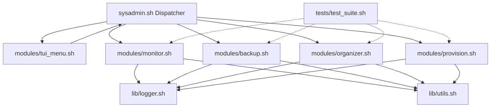

# Implementation Plan: OS Admin CLI Toolset

Build a modular, cross-platform (Linux/macOS/WSL) system administration CLI suite adhering to established project shell scripting rules, featuring 4 core modules, shared libraries, an interactive TUI menu, demo fixtures, and an automated test suite.

---

## User Review Required

> [!IMPORTANT]
> **Privilege Isolation for Module 4 (User Provisioning)**: Adding and deleting real system users requires `root`/`sudo`. The module will automatically check for root privileges, but will fully support non-root execution when `--dry-run` is supplied so grading and lab evaluations can run safely on any unprivileged account or test machine.

> [!NOTE]
> **TUI Engine Architecture**: The TUI wrapper in `modules/tui_menu.sh` will be implemented in pure Bash using ANSI terminal controls (arrow navigation, colored highlighting, full-screen buffer) so it runs anywhere without requiring external binaries (`dialog`, `whiptail`, or `fzf`). If `fzf` or `dialog` are present on the system, quick launch flags (`--fzf` / `--dialog`) can optionally be supported.

---

## Open Questions

None currently. All core architectural decisions were locked down during the design interview.

---

## Proposed Changes



---

### Component 1: Shared Core & Platform Utilities

#### [NEW] [lib/utils.sh](file:///d:/OS%20Project/lib/utils.sh)
- Detects host operating system (`Linux`, `Darwin` / macOS, `CYGWIN` / `MINGW` / WSL).
- Normalizes core utilities between GNU and BSD:
  - `calculate_sha256 <file>`: Uses `sha256sum` on Linux or `shasum -a 256` on macOS.
  - `get_file_size <file>`: Uses `stat -c %s` (GNU) or `stat -f %z` (BSD).
  - `get_file_mtime <file>`: Uses `stat -c %Y` (GNU) or `stat -f %m` (BSD).
  - `format_date_iso <epoch>`: Uses `date -d @<epoch>` (GNU) or `date -r <epoch>` (BSD).
- Provides ANSI color codes and cursor movement escape sequences for TUI rendering.
- Standard temporary directory manager with automatic cleanup registration.

---

### Component 2: Module 1 — System Resource & Process Monitor

#### [NEW] [modules/monitor.sh](file:///d:/OS%20Project/modules/monitor.sh)
- **Snapshot Mode**:
  - Collects CPU load averages, user/system percentage.
  - Collects Memory and Swap usage (Total, Used, Free, Percent).
  - Collects Disk space for mounted partitions (`df -h`).
  - Lists top $N$ CPU and Memory consuming processes (`ps aux`).
  - Outputs a cleanly formatted ASCII table.
- **Watch Mode (`--watch [interval]`)**:
  - Live refresh loop clearing screen and polling metrics every $N$ seconds.
- **Threshold Alert Engine**:
  - Evaluates CPU (`--cpu-threshold`), RAM (`--mem-threshold`), and Disk (`--disk-threshold`).
  - Emits color-coded alerts to terminal and logs to `LOG_FILE`.
  - Dispatches desktop alert via `notify-send` (Linux) or `osascript` (macOS) if available.
- **Flags**:
  - `--snapshot` (default)
  - `-w, --watch [interval_sec]`
  - `-c, --cpu-threshold <int>` (default: 80)
  - `-m, --mem-threshold <int>` (default: 85)
  - `-d, --disk-threshold <int>` (default: 90)
  - `-n, --top-n <count>` (default: 5)
  - `-h, --help`

---

### Component 3: Module 2 — Incremental Backup & Rotation Manager

#### [NEW] [modules/backup.sh](file:///d:/OS%20Project/modules/backup.sh)
- **Backup Engine**:
  - Uses `tar` with an incremental snapshot file (`.snar` metadata file via `--listed-incremental`).
  - First run creates a level-0 full backup; subsequent runs create level-1+ incremental archives.
  - Generates compressed archives (`.tar.gz`).
  - Generates companion `SHA256SUMS` manifest file for integrity verification.
- **Rotation Manager**:
  - Inspects `--dest` directory for existing backups matching timestamp format.
  - Prunes oldest archives when count exceeds `--retention <N>`, always retaining at least one complete restore chain.
- **Verification Subcommand (`--verify <archive>`)**:
  - Computes current SHA-256 and compares against recorded manifest.
  - Tests archive integrity (`tar -tzf <archive> > /dev/null`).
- **Flags**:
  - `-s, --source <dir>`
  - `-d, --dest <dir>`
  - `-r, --retention <N>` (default: 5)
  - `-v, --verify <archive>`
  - `--dry-run`: Simulates backup creation and rotation without filesystem writes.
  - `-h, --help`

---

### Component 4: Module 3 — Automated File Organizer & Log Cleaner

#### [NEW] [modules/organizer.sh](file:///d:/OS%20Project/modules/organizer.sh)
- **File Organizer (`--organize`)**:
  - Scans `--target <dir>` for loose files.
  - Categorizes files by extension:
    - `Documents/`: `pdf, doc, docx, txt, md, rtf, odt, xls, xlsx, ppt, pptx, csv`
    - `Images/`: `png, jpg, jpeg, gif, bmp, svg, webp, ico`
    - `Media/`: `mp4, mkv, avi, mov, mp3, wav, flac, aac`
    - `Archives/`: `zip, tar, gz, bz2, xz, 7z, rar`
    - `Code/`: `c, cpp, h, py, sh, js, ts, html, css, java, go, rs`
  - Moves files safely using null-delimited iteration (handles spaces, symbols).
- **Log Cleaner (`--clean-logs`)**:
  - Finds `.log` files in target.
  - Filters by age: `--older-than <days>` (default: 14).
  - Filters by size: `--max-size <MB>` (default: 50MB).
  - Actions:
    - Purges or archives logs older than threshold.
    - Compresses large logs to `.log.gz` or truncates with backup copy.
  - Supports `--quarantine <dir>` to stage files before permanent deletion.
- **Safety**:
  - Mandatory `--dry-run` prints all file moves, deletions, and compressions with `[DRY-RUN]` tag without touching disk.
- **Flags**:
  - `-t, --target <dir>`
  - `-o, --organize`
  - `-c, --clean-logs`
  - `--older-than <days>`
  - `--max-size <MB>`
  - `-q, --quarantine <dir>`
  - `--dry-run`
  - `-h, --help`

---

### Component 5: Module 4 — Bulk User & Permission Provisioning

#### [NEW] [modules/provision.sh](file:///d:/OS%20Project/modules/provision.sh)
- **CSV Parser & Schema Validator**:
  - Validates CSV header: `username,group,shell,home_dir,sudo_flag,initial_password`.
  - Rejects malformed rows with line numbers and reasons.
- **Provisioning Flow**:
  - Checks if group exists; creates group if missing (`groupadd` or `dscl`).
  - Checks if user exists; skips or warns on collision to avoid clobbering.
  - Creates user with designated primary group, home directory, and login shell.
  - Sets password (using `chpasswd` on Linux or `dscl` on macOS).
  - Adds user to `sudo` / `wheel` / `admin` group if `sudo_flag` is `yes` / `true`.
  - Sets home directory permissions (`700` or `750`).
- **De-provisioning Mode (`--deprovision`)**:
  - Reads CSV and removes created users (`userdel -r` or `sysadminctl`).
- **Safety**:
  - Non-root checks: if not root and `--dry-run` is NOT passed, exits with descriptive error.
  - Full `--dry-run` support: parses CSV, validates system state, and logs all commands that would be executed without needing root.
- **Flags**:
  - `-f, --csv <file>`
  - `--deprovision`
  - `--dry-run`
  - `-h, --help`

---

### Component 6: Interactive TUI Menu Wrapper

#### [NEW] [modules/tui_menu.sh](file:///d:/OS%20Project/modules/tui_menu.sh)
- **Interface Design**:
  - Pure Bash ANSI escape sequences (`\033[?25l`, `\033[H`, `\033[2J`, `\033[7m` for inverted selection bar).
  - Reads arrow keys (`\033[A`, `\033[B`), `j`/`k`, `Enter`, `1`-`6`, and `q`.
  - Smooth redraw without screen flickering.
- **Menu Options**:
  1. `[1] System Resource & Process Monitor` -> Submenu for Snapshot or Watch mode.
  2. `[2] Incremental Backup & Rotation Manager` -> Prompt for source/destination/retention.
  3. `[3] File Organizer & Log Cleaner` -> Prompt for target folder, organize vs log clean, dry-run toggle.
  4. `[4] Bulk User Provisioning from CSV` -> Interactive CSV path picker, dry-run toggle, run.
  5. `[5] View Recent System Logs` -> Paged viewer for `logs/sysadmin.log`.
  6. `[6] Run Automated Test Suite` -> Runs `tests/test_suite.sh`.
  7. `[q] Exit`

---

### Component 7: Unified Root Dispatcher

#### [NEW] [sysadmin.sh](file:///d:/OS%20Project/sysadmin.sh)
- Main CLI front-door executable.
- Syntax: `./sysadmin.sh <command> [options...]`
- Subcommands:
  - `monitor`: invokes `modules/monitor.sh`
  - `backup`: invokes `modules/backup.sh`
  - `organize`: invokes `modules/organizer.sh`
  - `provision`: invokes `modules/provision.sh`
  - `menu` / `tui` / (no args): launches `modules/tui_menu.sh`
  - `test`: runs `tests/test_suite.sh`
- Implements global `--help` listing all available subcommands.

---

### Component 8: Demo Fixtures & Automated Test Suite

#### [NEW] [examples/users.csv](file:///d:/OS%20Project/examples/users.csv)
- Sample CSV with valid users, groups, shells, and sudo privileges for testing.

#### [NEW] [examples/generate_sample_dir.sh](file:///d:/OS%20Project/examples/generate_sample_dir.sh)
- Helper script to generate a temporary disorganized directory with mixed extensions and dummy log files for testing Module 3.

#### [NEW] [tests/test_suite.sh](file:///d:/OS%20Project/tests/test_suite.sh)
- Automated unit and integration test runner.
- Test Cases:
  1. **Syntax & Standards**: Validates `bash -n` on all `.sh` files, checks for `set -euo pipefail` and shebang.
  2. **Platform Utilities**: Tests `lib/utils.sh` hashing, file size, OS detection.
  3. **Module 1**: Runs snapshot monitor, verifies exit code 0 and table structure.
  4. **Module 2**: Runs full backup, runs incremental backup, verifies `SHA256SUMS`, runs `--verify`, tests retention pruning, tests `--dry-run`.
  5. **Module 3**: Generates test files, runs `--organize --dry-run` (verifies files unmoved), runs real `--organize` (verifies files sorted), runs `--clean-logs` with `--older-than` and `--max-size`.
  6. **Module 4**: Tests CSV parsing, runs `--dry-run` validation without root, verifies collision detection.
  7. **Dispatcher**: Tests `./sysadmin.sh --help` and subcommands routing.
- Emits green/red pass/fail summary table with timing.

---

## Verification Plan

### Automated Tests
Run the complete automated test suite via Git Bash or Linux shell:
```bash
bash tests/test_suite.sh
```
Also verify all scripts pass strict Bash syntax checking:
```bash
find . -name "*.sh" -exec bash -n {} +
```

### Manual Verification
1. **Module 1 (Monitor)**:
   ```bash
   ./sysadmin.sh monitor --snapshot
   ./sysadmin.sh monitor --top-n 3
   ```
2. **Module 2 (Backup)**:
   ```bash
   ./sysadmin.sh backup --source examples/ --dest /tmp/test_backup --retention 2
   ./sysadmin.sh backup --verify /tmp/test_backup/<archive_name>.tar.gz
   ```
3. **Module 3 (Organizer)**:
   ```bash
   bash examples/generate_sample_dir.sh /tmp/messy_dir
   ./sysadmin.sh organize --target /tmp/messy_dir --organize --dry-run
   ./sysadmin.sh organize --target /tmp/messy_dir --organize
   ./sysadmin.sh organize --target /tmp/messy_dir --clean-logs --max-size 1
   ```
4. **Module 4 (Provisioning)**:
   ```bash
   ./sysadmin.sh provision --csv examples/users.csv --dry-run
   ```
5. **Interactive TUI**:
   ```bash
   ./sysadmin.sh
   # or
   ./sysadmin.sh menu
   ```
